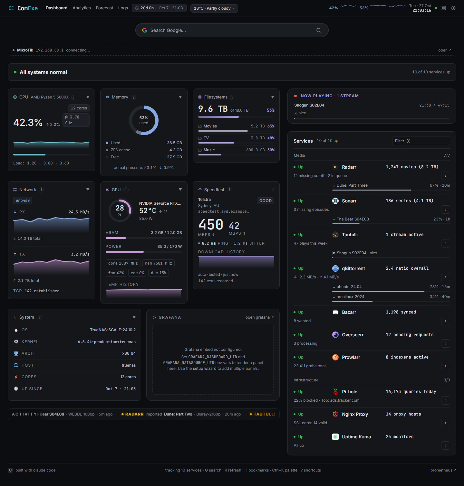
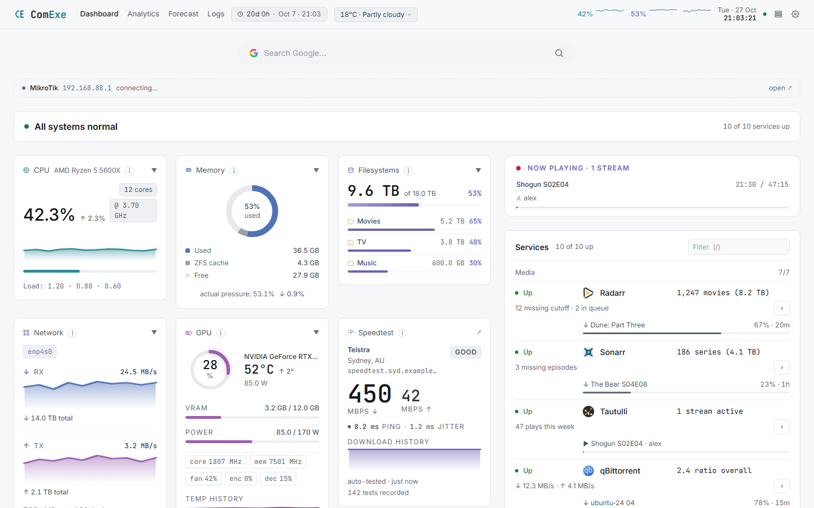
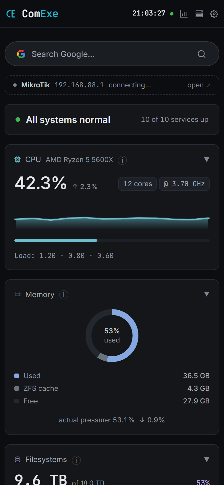
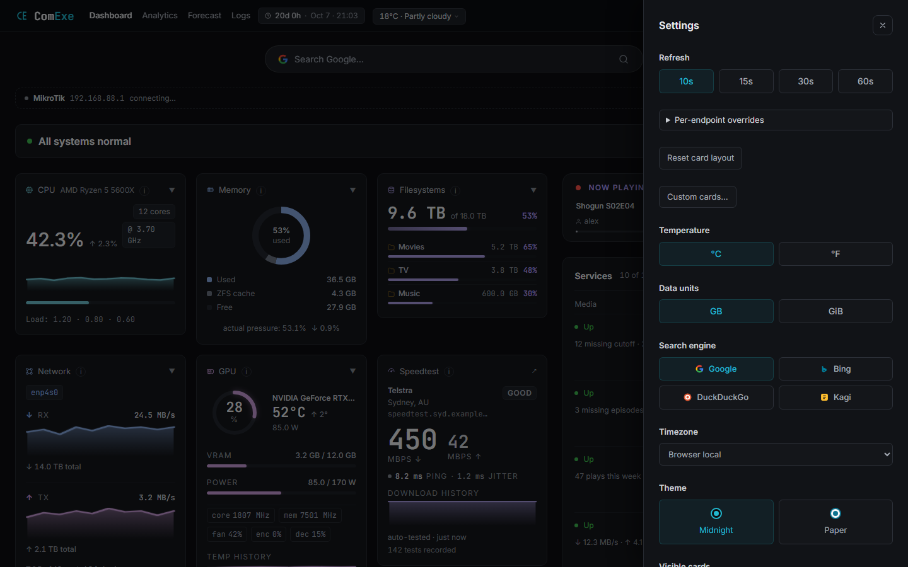
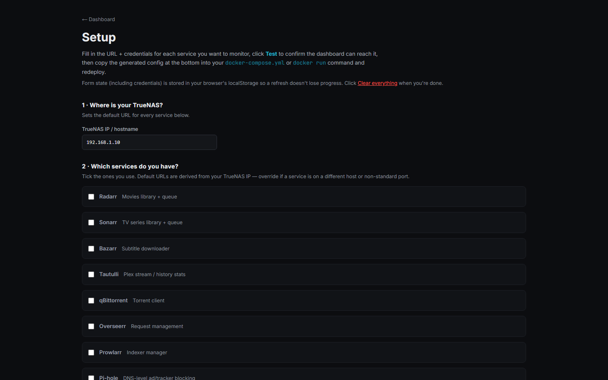

<p align="center">
  
</p>

<h1 align="center">ComExe</h1>

<p align="center">
  A calm, self-hosted dashboard for a TrueNAS Scale homelab.
</p>

<p align="center">
  
  
  
  
  
</p>

ComExe brings your homelab onto one page: live system metrics from Prometheus, the health of your
media and infrastructure services, Plex streams, downloads, speedtests and weather. The first
thing it shows is the answer to the only question that matters at a glance — **is anything
wrong?** — and colour only appears when something is.

Everything is set up from a web wizard with live "Test connection" buttons. No database, no
external state, no secrets in the browser: every upstream call goes through a server-side route.



<sub>All screenshots use the built-in demo data (append `?demo=1` to any URL) — no real services involved.</sub>

---

## Highlights

- **Status at a glance** — a summary line reads *All systems normal*, or lists exactly what needs
  attention: a crossed threshold, a service that's down or rejecting its credentials, *arr health
  errors (grouped across apps), stale data, Uptime Kuma monitors down, Prometheus exporters down.
  It also remembers: "last incident 10 h ago: Radarr unreachable for 12 min", with a 24-hour strip
  that shows anything that came and went while you weren't looking — and the browser tab shows it
  too ("2 issues · ComExe" and a coloured dot), so a pinned tab tells you without a look.
- **Calm by design** — flat cards, one soft accent per metric for its charts, and status colours
  (green / amber / red) reserved for actual problems, always paired with a word.
- **Services in one list** — Radarr, Sonarr, Bazarr, Tautulli, qBittorrent, Overseerr, Prowlarr,
  Pi-hole, Nginx Proxy Manager and Uptime Kuma, each with its own icon, status, key number,
  download queue or Plex stream and a 24-hour uptime strip, sorted so problems come first.
- **Now playing** — Plex streams with their posters, who's watching on what, and whether each is
  a direct play or a transcode (and whether the GPU is doing it).
- **What's coming up** — the week's episodes and movie releases from Sonarr and Radarr, by day,
  with anything that aired but never downloaded called out, next to recent grabs and watches.
- **Alerts with no tab open** — a background collector keeps evaluating thresholds and recording
  history around the clock, and sends webhooks to Discord, Slack, ntfy or any JSON endpoint,
  with throttling and quiet hours.
- **Set up in the browser** — the `/setup` wizard tests each service's credentials live, saves to a
  mounted volume and applies within seconds. Saved keys are never sent back to the browser, and a
  blank field keeps the saved one.
- **Gentle on your homelab** — one server-sent-events stream instead of many pollers, per-origin
  connection caps, a circuit breaker, memoised heavy calls and hard minimum intervals. (The first
  version polled every 3 s and crashed the *arr containers; this is the fix.)

## Screenshots

| Light theme (Paper) | Phone |
|---|---|
|  |  |

| Settings | Setup wizard |
|---|---|
|  |  |

---

## Features

### Metrics

- **CPU** — usage, load averages, cores and clock, history sparkline, and a per-thread heatmap
  that shows a single pegged thread the average hides
- **Memory** — used / ZFS cache / free, with ZFS-aware accounting (`MemTotal − MemAvailable − SReclaimable`)
  so the ARC doesn't look like a leak
- **Filesystems** — pool fullness, pool state and ZFS cache hit rate, a fill-up forecast ("reaches
  85% in about 2 years") from the last week's growth, and each dataset with its weekly growth
- **Network** — download above and upload below one chart, with a hover readout; totals and
  established TCP connections
- **GPU** — utilisation, temperature, power draw, VRAM, clocks, fan, encoder/decoder load
- **Speedtest** — latest result and a chart of the last 20 tests (download, upload, ping on hover)
  from SpeedTracker (read-only — it never triggers a test)
- **System** — OS, kernel, architecture, host, cores, uptime and last boot
- **Disk health** — every drive in one table, problems first: temperature against warm/hot limits
  suited to disks or NVMe, age, bad sectors and the last 24 hours; click a drive for its week and
  every SMART reading (needs the smartmon script — see INSTALL.md)
- **Grafana** — embed any panel; with an API token it renders server-side, no iframe cookies
- **Last 24 hours** — CPU, memory, network and GPU across the day on the dashboard itself, with
  the average, the peak and when it happened, and how much data moved

### Pages

- **Dashboard** — two columns on wide screens (metrics beside services), one on a phone
- **Analytics** — history charts for CPU, memory, GPU, disk and network over 1 h – 7 d
- **Forecast** — uptime / SLA, incidents and MTTR, anomaly detection, and when resources run out
- **Logs** — container log viewer with search, level filters and live tail (opt-in Docker access)
- **Setup** and a short **welcome** flow for first runs

### Everything else

Two themes (Midnight, Paper) · command palette (`Ctrl+K`) and keyboard shortcuts · bookmarks ·
MikroTik router bar, device list and Wake-on-LAN · network topology and service dependency map ·
multi-server fleet view · custom PromQL cards · drag-to-reorder cards and saved layouts ·
config backup and restore · optional password or auth-proxy login · PWA install.

---

## Install

A prebuilt multi-arch image (amd64 + arm64) is published to
**`ghcr.io/syedhashmi-bit/comexe:latest`** on every push to `main`. You don't need to clone or build anything.

> The full guide — TrueNAS Custom App walkthrough, docker-compose, bookmarks, Grafana and
> troubleshooting — is in **[INSTALL.md](./INSTALL.md)**.

### Quick start

```bash
mkdir -p dashboard-data

docker run -d \
  --name comexe \
  --network host \
  --restart unless-stopped \
  -v "$(pwd)/dashboard-data:/app/data" \
  ghcr.io/syedhashmi-bit/comexe:latest
```

Open **`http://<your-host>:3000/setup`**, enter your TrueNAS IP, tick the services you run, paste
each API key, click **Test**, then **Save & apply**.

The `dashboard-data` mount is what keeps your settings across updates. Without it the wizard
falls back to generating a `docker-compose.yml` / `docker run` snippet for you to apply yourself.

### Updating

Installed as a TrueNAS app (Install via YAML — see [INSTALL.md](INSTALL.md)), ComExe updates like
any other app: the Apps page shows **Update** once a new image is published.

For a plain `docker run` install, [`scripts/update-dashboard.sh`](scripts/update-dashboard.sh) is a
health-gated updater: it pulls the new image, starts it as a candidate on a spare port, only
replaces the running container once the candidate is healthy, keeps the previous image tagged
`:rollback`, and makes sure `/app/data` is on a host mount so nothing you configured is lost.

### Configuration

- **Wizard first** — `/setup` writes `data/config.json` on your mounted volume; changes apply in seconds.
- **Or env vars** — anything can be set with `docker run -e …` for headless deploys; the full list
  is in [`.env.local.example`](./.env.local.example).
- **Precedence** — wizard file › env vars › built-in defaults.
- **No secrets in the image** — credentials are read at request time, never baked in.

### Security

ComExe is built for a single user on a private LAN. Auth is off by default; set
`DASHBOARD_PASSWORD` for a login page, or `AUTH_PROXY_HEADER` behind Authelia / Authentik /
Cloudflare Access. It only answers to IP addresses, `localhost` and LAN-style names (anything
else is refused, which blocks DNS-rebinding attacks); list other hostnames in
`COMEXE_ALLOWED_HOSTS`. See [INSTALL.md](./INSTALL.md#security-notes).

---

## Alert thresholds

| Metric | Warning | Critical |
|---|---|---|
| CPU usage | > 80 % | > 95 % |
| Memory (real, ZFS-aware) | > 93 % | > 97 % |
| Filesystem usage | > 85 % | > 95 % |
| GPU temperature | > 80 °C | > 90 °C |
| Service unreachable | — | any configured service |
| Service health checks | ≥ 1 warning | ≥ 1 error |

[`app/lib/alerts.ts`](app/lib/alerts.ts) and [`app/lib/alert-events.ts`](app/lib/alert-events.ts)
are authoritative.

## Keyboard shortcuts

| Key | Action |
|---|---|
| `G` | Focus the search bar |
| `R` | Refresh everything now |
| `H` | Toggle bookmarks |
| `/` | Filter services |
| `Ctrl+K` | Command palette |
| `?` | Shortcuts overlay |
| `Esc` | Close panels / leave an input |

---

## Reference hardware

| Component | Spec |
|---|---|
| CPU | Intel Xeon E5-2680 v4 (28 cores) |
| RAM | 63 GB ECC |
| GPU | NVIDIA GeForce GTX 1660 SUPER (6 GB) |
| Storage | 4.4 TB ZFS pool |
| OS | TrueNAS Scale (Electric Eel 24.10+, runs apps on plain Docker) |
| Router | MikroTik hAP ax³ — RouterOS 7.22.x |
| Network | `192.168.88.0/24` flat LAN |

---

## How it works

```
browser ──── one SSE stream (/api/stream) ────┐
                                              ▼
                              Next.js server routes (37)
        ┌────────────┬──────────────┬─────────┴───────┬──────────────┐
   Prometheus   *arr / Plex /   SpeedTracker      MikroTik      open-meteo
   (~30 PromQL) Pi-hole / … (10)  (read-only)      (REST)       (weather)
                                              ▲
            background collector ─────────────┘  alerts, webhooks, history.jsonl
```

- **Server-side only** — the browser never calls internal IPs, so credentials stay on the server
  and CORS never comes up.
- **One stream, polling as fallback** — `/api/stream` pushes metrics, services, router, activity,
  speedtest and weather on their own timers; if it fails three times the page falls back to polling.
- **Load protection** — max 2 sockets per upstream, a per-origin circuit breaker, 5-minute memoisation
  of heavy library calls, staged batches, and minimum intervals users can't override.
- **Background collector** — evaluates alerts and appends history even with no tab open; while a
  tab is connected it reuses the stream's data instead of polling again.
- **No chart libraries** — every sparkline, donut, gauge and chart is hand-written SVG or Canvas.

| Layer | Choice |
|---|---|
| Framework | Next.js 16 (App Router, 7 pages, 35 components) |
| Language | TypeScript 6 |
| Styling | Tailwind CSS 3, CSS variables for the two themes |
| Charts | Inline SVG and Canvas, no chart library |
| Runtime | Node 22 in a multi-stage Docker image |
| Tests | Vitest (315 unit tests) and Playwright (end-to-end) |

---

## Local development

```powershell
npm install
npm run dev          # http://localhost:3000 — add ?demo=1 for sample data
npm run lint
npx tsc --noEmit
npm test             # vitest
npm run test:e2e     # playwright
npm run storybook    # primitives sandbox on :6006
```

CI runs lint, the type check and the unit tests before any image is published, plus the
end-to-end suite as a separate job. Architecture notes and conventions live in
[`CLAUDE.md`](./CLAUDE.md).

<details>
<summary>Project structure</summary>

```
.
├── app/
│   ├── api/                 37 server routes — metrics, services, stream (SSE), alerts,
│   │                        history, insights, config, test-connection, docker, smart, …
│   ├── components/          StatusSummary, ServicesPanel, PageHeader, SettingsPanel,
│   │                        primitives (Card, Sparkline, gauges), …
│   ├── hooks/               useEventStream (SSE with polling fallback), usePolling
│   ├── lib/                 32 shared modules — config resolution, http + circuit
│   │                        breaker, caches, collector, alerts, formatters, …
│   ├── analytics/ forecast/ logs/ setup/ welcome/ login/
│   ├── globals.css          Theme tokens (Midnight, Paper) and layout
│   └── page.tsx             Dashboard
├── instrumentation.ts       Starts the background collector
├── proxy.ts                 Auth and hostname guard
├── scripts/update-dashboard.sh   Health-gated updater for docker run installs
├── docs/screenshots/        README images (captured from demo mode)
├── Dockerfile               Multi-stage build
└── INSTALL.md · CLAUDE.md · .env.local.example
```

</details>

---

## License

MIT
